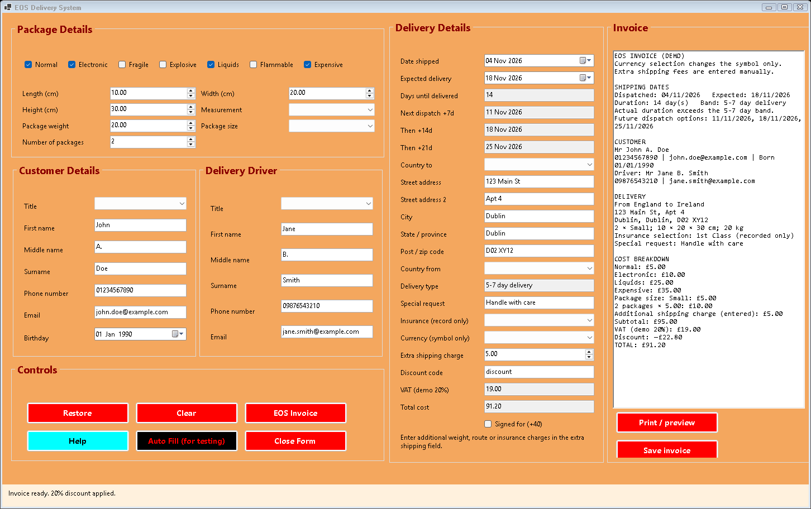

# EOS delivery and quotation system

A C# Windows Forms app for delivery quotes and invoices, based on my EOS coursework at SRC Newry. Enter the customer and package details, calculate the price, then save or print the invoice.



## Try it

Download **EosDelivery-windows-x64.zip** from [Releases](https://github.com/JamieP-205/eos-delivery-system/releases/latest), extract it and run `EosDelivery.exe`. The Windows x64 release includes its .NET runtime.

Demo login: **JamieP** / **password123**. Select **Auto Fill (for testing)**, then **EOS Invoice**. Use `discount` for 20% off. Clear and restore the form, save an invoice, or open print preview.

To run from source with the [.NET 10 SDK](https://dotnet.microsoft.com/download/dotnet/10.0) on Windows:

```powershell
dotnet run --project EosDelivery.csproj
```

## Features

- Customer and delivery-driver details, package categories, dimensions and weight.
- Package-size and quantity charges, VAT, discounts and an itemised total.
- Input validation for weight, quantity, age, email and delivery dates.
- Shipping-date calculations and future dispatch options.
- Clear and restore, sample data, help and password visibility controls.
- Invoice text export and native Windows print preview.

`Quote.cs` handles validation, prices and invoice text. `Program.cs` contains the forms.

## Checks

```powershell
dotnet build -c Release
Start-Process .\bin\Release\net10.0-windows\EosDelivery.exe -ArgumentList '--verify','docs' -WindowStyle Hidden -Wait
Get-Content .\docs\verification.json
```

There are 24 checks for prices, discounts, weight conversions, age and date limits, login lockout, form layout, clear/restore and updating invoices after an edit. See the [results](docs/verification.json), [Windows UI checks](docs/ui-checks.md) and [example invoice](docs/example-invoice.txt). GitHub Actions runs the checks on pushes and pull requests.

## Demo behaviour

The app uses a fixed demo login and fictional sample details. It keeps data in memory unless an invoice is saved or printed. No booking or payment service is connected.

Currency selection changes the symbol only. Package weight is entered manually. Additional shipping fees use the extra-charge field; insurance selection is recorded on the invoice. The demonstration VAT rate is 20%. See [calculation notes](docs/calculations.md) for the tariff and validation rules.
